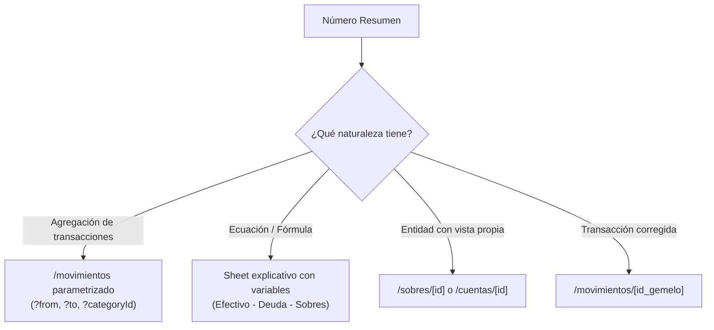

# Brief: Patrón de Desglose de Totales ("De la Cifra a su Origen")

> **Problema de fondo:** La app presenta números consolidados que actúan como paredes ciegas. El usuario los lee, duda de su veracidad o no entiende de dónde salieron, y no tiene forma de tocarlos para auditar su composición.
> **Objetivo:** Unificar la interacción de toda la app bajo una regla coherente: todo número resumen debe poder auditarse.

---

## 1. Inventario Exhaustivo de Números en las 9 Pantallas

| Pantalla | Número / Total | Qué lo compone | Endpoint de origen | ¿Desglose accesible hoy? |
|---|---|---|---|---|
| **Inicio (`/`)** | **Por asignar** (ej. `$24,680.00`) | Dinero real en cuentas − Asignaciones del periodo | `GET /insights/dashboard` (`unassignedCents`) | ❌ No. Cifra estática en tarjeta héroe. |
| **Inicio (`/`)** | **Gastado en periodo** (ej. `$2,570.50`) | Suma de gastos con fecha dentro del periodo | `GET /insights/dashboard` (`period.spentCents`) | ❌ No. Texto plano sin enlace. |
| **Inicio (`/`)** | **Movimientos sin periodo** (ej. `1`) | Conteo de transacciones fuera de periodos | `GET /insights/dashboard` (`unbudgetedEntries`) | ❌ No. Banner informativo plano. |
| **Inicio (`/`)** | **Déficit en sobregiro** (ej. `-$650.00`) | Suma de saldos negativos de sobres | `GET /insights/dashboard` (categorías `overspent`) | ⚠️ Parcial. [Cubrir] abre la hoja, pero la cifra no se desglosa. |
| **Inicio (`/`)** | **Saldo por sobre** (ej. `$3,269.50`) | Asignado − Gastado + Rollover previo | `GET /insights/dashboard` (`categories[].availableCents`) | ❌ No. En Inicio los renglones son `` mudos. |
| **Sobres (`/sobres`)** | **Asignado en tarjeta** (ej. `$4,120.00`) | Asignación inicial + Traspasos recibidos | `GET /categories` (`period.assignedCents`) | ❌ No. Solo hay un input para sobreescribir. |
| **Sobres (`/sobres`)** | **Gastado en tarjeta** (ej. `$850.50`) | Cargos del periodo contra este sobre | `GET /categories` (`period.spentCents`) | ❌ No. El monto no es clickeable. |
| **Sobres (`/sobres`)** | **Disponible en tarjeta** (ej. `$3,269.50`) | Asignado − Gastado | `GET /categories` (`period.availableCents`) | ⚠️ Parcial. Solo si se adivina dar clic al título del sobre. |
| **Detalle Sobre (`/sobres/[id]`)** | **Histórico** (ej. `Balance: $850.50`) | Suma histórica de gastos acumulados | `GET /categories` (`balanceCents`) | ❌ No. Texto plano al pie del formulario. |
| **Cuentas (`/cuentas`)** | **Total en mano** (ej. `$36,429.50`) | Efectivo en banco y cartera − Deuda en TDC | `GET /insights/dashboard` (`realMoneyCents`) | ❌ No. Tarjeta estática sin interactividad. |
| **Cuentas (`/cuentas`)** | **En cuentas / Deuda** (`$41,709` / `$5,280`) | Sumas de cuentas tipo `cash` y tipo `credit` | `GET /insights/dashboard` (`accountsSummary`) | ❌ No. Texto secundario sin desglose. |
| **Cuentas (`/cuentas`)** | **Saldo de cuenta** (ej. `$24,500.00`) | Suma de movimientos en el ledger de la cuenta | `GET /accounts` (`balanceCents`) | ✅ **Sí.** La tarjeta completa enlaza a `/cuentas/[id]`. |
| **Movimientos (`/movimientos`)** | **Insignia "Corregida" / "Corrección"** | Vinculación a la transacción reversada/reversa | `GET /transactions` (`reversedBy...`, `reverses...`) | ❌ No. Badges planos; no enlazan al movimiento gemelo. |
| **Cierre (`/periodos/.../cerrar`)** | **Impacto total** (4 tarjetas) | Suma de congelados, gastados y liberados | `GET /periods/:id/close-preview` | ❌ No. Solo informativas. |

---

## 2. Diagnóstico de Rutas Existentes vs. Faltantes

### Pantallas que YA EXISTEN pero están incomunicadas:
1. **`/sobres/[categoryId]` (`CategoryDetailView.tsx`)**:
   - **Estado:** 100% terminada y funcional.
   - **Qué tiene:** Nombre editable, Asignado, Gastado, Disponible, Histórico, Política de rollover (`reset`/`accumulate`) y **lista de movimientos del sobre** (`useCategoryLedger`).
   - **Por qué no se alcanza:** En Inicio el sobre es texto plano (``). En `/sobres` solo el título `{category.name}` tiene enlace, pero luce como texto idéntico al resto de la tarjeta. Tocar el renglón de gasto o disponibilidad no hace nada.
2. **`/movimientos` con filtros de URL**:
   - **Estado:** 100% funcional.
   - Ya soporta:
     - `/movimientos?from=YYYY-MM-DD&to=YYYY-MM-DD` (movimientos de un periodo).
     - `/movimientos?categoryId=UUID` (movimientos de un sobre específico).
     - `/movimientos?accountId=UUID` (movimientos de una cuenta específica).
   - **Problema:** Ningún total de la app enlaza a estas URLs parametrizadas.

### Pantallas que NO EXISTEN:
1. **`/periodos/[periodId]` (Detalle de periodo)**:
   - Solo existen `/periodos` (lista) y `/periodos/[id]/cerrar`.
   - **¿Hace falta crear una pantalla nueva? NO.** Un periodo en esencia es una ventana de tiempo: entrar a un periodo es ver sus movimientos (`/movimientos?from=...&to=...`) y sus sobres presupuestados.

---

## 3. El Dictamen del Council: Reglas del Patrón de Desglose

### Regla 1: Cuándo un número es tocable y cuándo no
Dividimos los números en dos naturalezas contables:
1. **Totales de Agregación (Suma de transacciones reales):**
   - *Ejemplos:* "Gastaste $2,570.50 en este periodo", el gasto de un sobre, los movimientos sin periodo.
   - **Regla:** **SIEMPRE TOCABLES.** Su destino es la lista filtrada de las transacciones exactas que los componen.
2. **Totales de Ecuación (Fórmulas conceptuales):**
   - *Ejemplos:* "Por asignar" ($24,680.00), "Total en mano" ($36,429.50), "Liberado para asignar".
   - **Regla:** **TOCABLES PARA EXPLICACIÓN.** No existe un listado de transacciones que sume $24,680.00; lo que hay es una ecuación. Tocarlo debe abrir un **Sheet informativo de desglose aritmético**.
3. **Métricas en pantallas de edición (Inputs):**
   - El número que está dentro de un campo de texto para asignar dinero (ej. input de asignación) **no es tocable**, es editable.

---

### Regla 2: A dónde lleva cada tipo de número

1. **"Gastaste $2,570.50 este periodo"** (Inicio) → Navega a `/movimientos?from=${period.startsOn}&to=${period.endsOn}`.
2. **"Gastado $850.50" en Comida** (Sobres) → Navega a `/movimientos?categoryId=${comidaId}&from=${period.startsOn}&to=${period.endsOn}`.
3. **"1 movimiento no cae en ningún periodo"** (Banner) → Tocar el banner navega directo a `/movimientos/${unbudgetedId}` (o `/movimientos` filtrado a huérfanos).
4. **"Sobre en Inicio"** (Comida, Salud, etc.) → Tocar el renglón navega a `/sobres/${category.id}`.
5. **"Por asignar" ($24,680.00)** → Abre un Sheet limpio: *"De dónde sale este dinero"*, con la resta visual paso a paso:
   - Dinero real en cuentas: `+$36,429.50`
   - Total ya repartido en sobres: `-$11,749.50`
   - **Listo para asignar:** **`$24,680.00`**
6. **"Total en mano" ($36,429.50)** en `/cuentas` → Abre un Sheet: *"Composición de tu dinero disponible"*:
   - Efectivo y cuentas de débito: `+$41,709.50`
   - Deuda acumulada en tarjetas: `-$5,280.00`
   - **Dinero neto real:** **`$36,429.50`**
7. **Movimiento con insignia [Corregida]** → La insignia se vuelve botón interactivo: *"Ver corrección →"*, que lleva directo al movimiento inverso. Y en el movimiento de corrección: *"Ver movimiento original →"*.

---

### Regla 3: Cómo se ve que un número es tocable (Sin llenar la app de flechas)
- **Prohibido:** Colocar flechitas `>` al lado de cada número o subrayar todo el texto.
- **La solución afable:**
  1. **Superficie táctil completa (Card / Row):** En listas de sobres o cuentas, el área de la tarjeta completa tiene retroalimentación táctil (`hover:bg-muted-background/40 active:scale-[0.99] transition-all cursor-pointer`).
  2. **Subrayado sutil al hover en números específicos:** Cuando un número dentro de una tarjeta lleva a un filtro más específico que la tarjeta (ej. el número "Gastado" vs. el sobre), el número tiene `hover:text-primary transition-colors cursor-pointer`.
  3. **Insignias y Banners accionables:** En vez de un banner estático, el texto dice claramente la acción: *"1 movimiento sin periodo · **Ver movimiento →**"*.

---

## 4. Matriz de Viabilidad con el Backend Actual (Cerrado)

| Funcionalidad del Patrón | ¿Viable con Backend actual? | Razón técnica / Datos faltantes |
|---|---|---|
| **Ver gastos del periodo desde Inicio** | ✅ **100% Viable** | `/movimientos?from=...&to=...` ya funciona con los datos actuales. |
| **Ver gastos de un sobre específico** | ✅ **100% Viable** | `/sobres/[id]` ya consulta `/categories/:id/ledger` y `/movimientos?categoryId=...` ya filtra por sobre. |
| **Explicación visual de "Por asignar"** | ✅ **100% Viable** | `GET /insights/dashboard` ya devuelve `realMoneyCents`, `unassignedCents` y las categorías. Solo requiere el Sheet visual en front. |
| **Explicación visual de "Total en mano"** | ✅ **100% Viable** | `GET /insights/dashboard` ya devuelve `accountsSummary` con `cashCents` y `creditDebtCents`. |
| **Navegar desde banner de huérfano** | ✅ **100% Viable** | `unbudgetedEntries` ya incluye el `id` de la transacción. |
| **Trazabilidad de movimiento Corregido / Corrección** | ✅ **100% Viable** | `Transaction` ya contiene `reversedByTransactionId` y `reversesTransactionId`. |
| **Ver movimientos de un periodo desde `/periodos`** | ✅ **100% Viable** | Se resuelve enlazando cada renglón de periodo a `/movimientos?from=${p.startsOn}&to=${p.endsOn}`. |
| **Historial de asignaciones de un sobre (cuándo le puse/quité presupuesto)** | ❌ **BLOQUEADO POR BACKEND** | La API solo devuelve `POST /periods/:id/allocations/set` y `move`. No existe un endpoint `GET /allocations?categoryId=...` para listar el historial cronológico de cambios de presupuesto de un sobre. |
| **Historial de confirmaciones de un recordatorio** | ❌ **BLOQUEADO POR BACKEND** | La tabla `recurring_templates` solo guarda `last_confirmed_on` (última fecha). No hay historial de todas las confirmaciones pasadas de un template recurrente. |
| **Filtrar movimientos de cuenta por periodo en `/cuentas/[id]`** | ❌ **BLOQUEADO POR BACKEND** | El endpoint de cuenta `GET /accounts/:id/entries` solo soporta paginación por cursor, no filtros `from`/`to`. (Aunque se puede paliar enlazando a `/movimientos?accountId=...&from=...`). |
